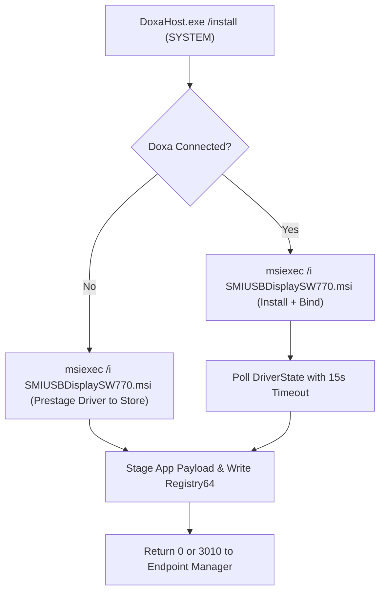

# Independent Engineering Review: Standivarius Doxa Setup

**Target Product:** Standivarius Doxa Setup (Portable Three-Monitor Display Solution)
**Host Version:** `0.4.0-preview.12`
**Review Scope:** Full native Windows C# host source (`DoxaHost.cs`), customer-facing guided setup script (`Start-DoxaGuidedSetup.ps1`), packaging model, and enterprise deployment architecture.
**Review Constraints & Limitations:** Evaluated strictly using read-only analysis without command execution or environment modification. Directory enumeration was not available; individual file inspection was limited to `DoxaHost.cs` and `Start-DoxaGuidedSetup.ps1`. Supplemental files referenced in scripts (`Start-DoxaSetup.ps1`, `Get-DoxaCloudAIPolicy.ps1`, `LOCAL-CHECK-NOTICE.txt`) and artifacts in `evidence/` could not be directly inspected.

---

## 1. Executive Readiness Conclusion

**NOT READY FOR RELEASE.**

While the core C# host exhibits commendable defensive engineering in payload integrity, driver hash validation, and avoiding unsolicited reboots, the package has **critical architectural flaws in enterprise staging, driver binding verification, and runtime execution** that will cause silent deployment failures in corporate environments (Intune / ManageEngine) and silent UI launch failures for standard users. Furthermore, external qualification remains incomplete: the development machine has a pre-existing healthy driver, current Intune qualification is still in progress, no ManageEngine agent test has occurred, and binaries/scripts lack a trusted commercial code-signing certificate.

---

## 2. What Is Ready

1. **Driver Integrity & Pinning:** [`DoxaHost.VerifyAndUnpackDriver`](file:///C:/mcp/vision-dev/state/reviews/doxa-full-installer-independent-high-20261028/DoxaHost.cs) enforces an exact SHA-256 fingerprint check (`DriverHash = 3379B46DA029423748E2D2E64DB2015B50136E310A492E31857CC726719192D4`) against the vendor-signed `SMIUSBDisplaySW770.msi` before staging.
2. **Reboot Suppression:** [`DoxaHost.InstallDriver`](file:///C:/mcp/vision-dev/state/reviews/doxa-full-installer-independent-high-20261028/DoxaHost.cs) invokes `msiexec.exe` with `/norestart` and traps MSI exit code `3010` (`RebootCode`), passing it back cleanly to enterprise endpoint management without triggering spontaneous system reboots.
3. **Safe File Retention Pattern:** [`DoxaHost.RemoveAppFrom`](file:///C:/mcp/vision-dev/state/reviews/doxa-full-installer-independent-high-20261028/DoxaHost.cs) refuses to delete modified or redirected application roots, atomically renaming unexpected customer contents to `DoxaRetained-<guid>` on the same volume.
4. **Decoupled Detection Logic:** [`DoxaHost.DetectDecision`](file:///C:/mcp/vision-dev/state/reviews/doxa-full-installer-independent-high-20261028/DoxaHost.cs) correctly assesses software installation independently from hardware presence, preventing Intune detection flapping when Doxa hardware is unplugged.
5. **Driver Preservation on Removal:** [`DoxaHost.Remove`](file:///C:/mcp/vision-dev/state/reviews/doxa-full-installer-independent-high-20261028/DoxaHost.cs) retains signed display drivers upon software uninstall, preventing display disconnects on multi-purpose workstations.

---

## 3. Critical Blockers & Software Risks

### Priority 1: Enterprise Driver Deployment Defect (Hardware-Gated Staging)
- **Location:** [`DoxaHost.Apply`](file:///C:/mcp/vision-dev/state/reviews/doxa-full-installer-independent-high-20261028/DoxaHost.cs) & [`DoxaHost.InstallDriver`](file:///C:/mcp/vision-dev/state/reviews/doxa-full-installer-independent-high-20261028/DoxaHost.cs)
- **Mechanism:** In `Apply()`, driver installation is gated on physical connection: `string driver = plugged ? InstallDriver(driverPackage) : "DriverDeferredUntilConnection"`. Furthermore, `InstallDriver()` mandates `Require(PresentUsb(), "Doxa is not connected")`.
- **Impact:** Corporate IT deployments (Intune / ManageEngine) run during staging, Autopilot, or off-hours when the laptop is disconnected from Doxa hardware. In this standard scenario, the vendor driver MSI is completely skipped. When a non-administrative employee later connects the hardware, Windows lacks the driver in the Driver Store. The standard user cannot trigger driver installation because `Apply()` requires elevation (`Require(Elevated)`), resulting in an immediate IT helpdesk blocker.

### Priority 1: WMI Driver Classification Fragility & PnP Binding Race
- **Location:** [`DoxaHost.DriverState`](file:///C:/mcp/vision-dev/state/reviews/doxa-full-installer-independent-high-20261028/DoxaHost.cs) & [`DoxaHost.ClassifyDriver`](file:///C:/mcp/vision-dev/state/reviews/doxa-full-installer-independent-high-20261028/DoxaHost.cs)
- **Mechanism:**
  1. `ClassifyDriver()` performs strict string equality: `provider.Equals("SiliconMotion", ...)` and `signer.Equals("Microsoft Windows Hardware Compatibility Publisher", ...)`. If WHQL certification labels the provider as `"Silicon Motion"` (with space), `"Silicon Motion, Inc."`, or uses program signer strings, it classifies the driver as state `2` (`DriverUntrusted`).
  2. If any sub-interface on the composite USB device (e.g., hub, control endpoint) returns state `2`, `DriverState()` terminates immediately with `return 2`.
  3. In `InstallDriver()`, `Require(DriverState() == 1, ...)` executes immediately following `msiexec` exit. Windows PnP driver binding is asynchronous; without a polling delay, `DriverState()` frequently returns `0` before PnP completes device binding, throwing a false-positive fatal exception.

### Priority 2: PowerShell Dependency & Enterprise Execution Policy / WDAC Lockout
- **Location:** [`DoxaHost.Open`](file:///C:/mcp/vision-dev/state/reviews/doxa-full-installer-independent-high-20261028/DoxaHost.cs) & [`Start-DoxaGuidedSetup.ps1`](file:///C:/mcp/vision-dev/state/reviews/doxa-full-installer-independent-high-20261028/app/packaging/doxa-setup/personal-ui/Start-DoxaGuidedSetup.ps1)
- **Mechanism:** `Open()` executes `powershell.exe -NoProfile -ExecutionPolicy Bypass -File ...`. Under corporate environments with Windows Defender Application Control (WDAC) or AppLocker, PowerShell runs in Constrained Language Mode (CLM). Parameter `-ExecutionPolicy Bypass` cannot override CLM. In CLM, `Add-Type -AssemblyName System.Windows.Forms` is blocked, terminating the script instantly.
- **Supplemental Script Missing:** Line 75 of `Start-DoxaGuidedSetup.ps1` calls `& $policyScript` (`Get-DoxaCloudAIPolicy.ps1`) under `$ErrorActionPreference = 'Stop'`. If supplemental helper scripts are missing from disk, guided setup crashes upon launch.

### Priority 2: Start Menu Shortcut Silent Failure Mode
- **Location:** [`DoxaHost.InstallMaintenance`](file:///C:/mcp/vision-dev/state/reviews/doxa-full-installer-independent-high-20261028/DoxaHost.cs), [`DoxaHost.Open`](file:///C:/mcp/vision-dev/state/reviews/doxa-full-installer-independent-high-20261028/DoxaHost.cs), & [`DoxaHost.Main`](file:///C:/mcp/vision-dev/state/reviews/doxa-full-installer-independent-high-20261028/DoxaHost.cs)
- **Mechanism:** The Start menu shortcut targets `DoxaMaintenance-v2.exe /open`. If an integrity mismatch or missing script occurs, `Open()` throws `InvalidOperationException`. In `Main()`, command exceptions write to `Console.Error` and return code `30`. Because shortcut launches do not attach a console window, no dialog appears; the process terminates invisibly, leaving the end-user with no feedback.

### Priority 2: Hyper-Rigid Manifest Validation
- **Location:** [`DoxaHost.IsValidApp`](file:///C:/mcp/vision-dev/state/reviews/doxa-full-installer-independent-high-20261028/DoxaHost.cs)
- **Mechanism:** `IsValidApp()` hardcodes `source != 20 || allowed.Count != 23` and checks `files.Length == allowed.Count`. If any third-party tool, antivirus scanner, local log, or user drops a single auxiliary file into `AppRoot`, `files.Length == allowed.Count` evaluates to `false`. This causes `/detect` to return failure, breaks `/open`, and triggers unintended directory isolation into `DoxaRetained-...` during maintenance operations.

### Priority 3: Deficient Repair Support
- **Location:** [`DoxaHost.InstallMaintenance`](file:///C:/mcp/vision-dev/state/reviews/doxa-full-installer-independent-high-20261028/DoxaHost.cs) & [`DoxaHost.Run`](file:///C:/mcp/vision-dev/state/reviews/doxa-full-installer-independent-high-20261028/DoxaHost.cs)
- **Mechanism:** Despite the stated product requirement for "normal repair/uninstall", the host explicitly writes `NoRepair = 1` into the Windows Uninstall registry key, and `Run()` contains no `/repair` command path.

### Priority 3: Incomplete Accessibility Localization & Initial UI State
- **Location:** [`DoxaHost.UI`](file:///C:/mcp/vision-dev/state/reviews/doxa-full-installer-independent-high-20261028/DoxaHost.cs)
- **Mechanism:**
  1. `AccessibleName` values on action buttons are assigned once in English and are not updated inside `updateText()`. Screen readers announce English descriptions when Romanian is selected.
  2. The status label initializes to `"Ready"` rather than actively querying `State()`, misleading users until manual interaction occurs.

### Priority 3: 32-bit vs. 64-bit Registry Hive Ambiguity
- **Location:** [`DoxaHost.IsRegistered`](file:///C:/mcp/vision-dev/state/reviews/doxa-full-installer-independent-high-20261028/DoxaHost.cs) & [`DoxaHost.InstallMaintenance`](file:///C:/mcp/vision-dev/state/reviews/doxa-full-installer-independent-high-20261028/DoxaHost.cs)
- **Mechanism:** Registry calls use `Registry.LocalMachine.OpenSubKey()` without requesting `RegistryView.Registry64`. If invoked from 32-bit management agents, lookups redirect to `WOW6432Node`, failing detection against a 64-bit registered host.

---

## 4. Release & Verification Status

| Dimension | Verification Status | Evaluation / Risk |
| :--- | :--- | :--- |
| **Local Fixtures / Unit Tests** | **Passed** | Clean/tampered app installations and payload extraction verified in isolated temp dirs. |
| **Real Hardware Acceptance** | **Incomplete** | Executed only on a machine with a pre-existing signed driver; first-time hardware driver binding never exercised. |
| **Intune Qualification** | **In Progress** | Current-binary qualification not confirmed; previous RC tests do not guarantee current build pass. |
| **ManageEngine Qualification** | **Untested** | No active agent validation in environment. |
| **Code Signing & SmartScreen** | **Unsigned** | Untrusted binary/scripts will trigger SmartScreen blocks and fail WDAC / corporate execution policies. |

---

## 5. Recommended Engineering Corrections

1. **Prestage Driver in Silent Enterprise Installs:** Remove the `PresentUsb()` precondition from `InstallDriver()`. Allow `msiexec /i package /qn /norestart` to register driver packages into the Windows Driver Store even when hardware is absent, enabling automatic standard-user PnP binding upon first connection.
2. **Add PnP Settling Polling in `InstallDriver`:** Replace the instant `DriverState() == 1` assertion with a polling loop (e.g., up to 15 seconds, checking every 1 second) to allow PnP worker threads to bind the driver node.
3. **Broaden Driver Provider Matching:** In `ClassifyDriver()`, sanitize provider strings (`provider.Replace(" ", "")`) and match known vendor signatures permissively (e.g., starts with `"Silicon Motion"` or `"SiliconMotion"`).
4. **Make `Open()` Resilient and User-Facing:** Wrap `Open()` errors in a `MessageBox.Show` if `Environment.UserInteractive` is true. Migrate UI guidance into native WinForms within `DoxaHost` to eliminate reliance on external PowerShell and avoid CLM/WDAC blocks.
5. **Enforce 64-Bit Registry View:** Replace `Registry.LocalMachine` calls with:
   `RegistryKey.OpenBaseKey(RegistryHive.LocalMachine, RegistryView.Registry64).OpenSubKey(RegKey)`
6. **Implement Real Repair:** Remove `NoRepair = 1`, provide a `/repair` handler in `Run()`, and update `AccessibleName` strings within `updateText()`.
7. **Production Signing:** Sign `DoxaHost.exe`, internal payload executables, and PowerShell scripts with a valid commercial Authenticode certificate prior to release qualification.
